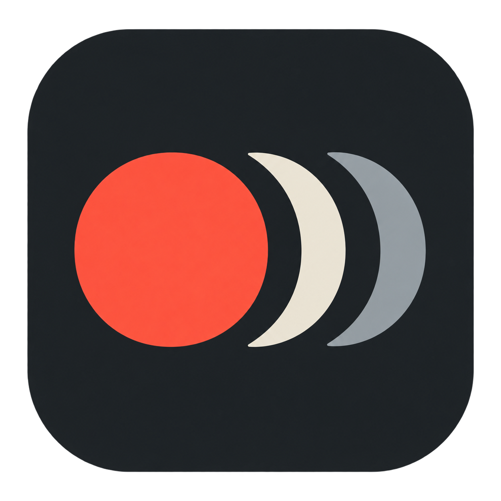
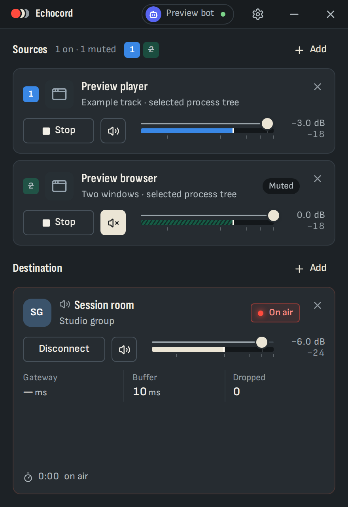

<p align="center">
  
</p>
<h1 align="center">Echocord</h1>
<p align="center">Stream local audio into Discord as your own bot.</p>
<p align="center">
  <a href="https://github.com/dokzlo13/echocord/releases/latest"></a>
  <a href="https://github.com/dokzlo13/echocord/actions/workflows/ci.yml"></a>
  <a href="LICENSE"></a>
  
</p>
<p align="center">
  <a href="https://github.com/dokzlo13/echocord/releases/latest"><strong>Download for Windows</strong></a> ·
  <a href="#discord-bot-setup">Set up your bot</a> ·
  <a href="CONTRIBUTING.md">Contribute</a>
</p>

Echocord captures audio from selected applications or recording devices, mixes it locally, and sends it to Discord voice rooms. Each source and destination has its own gain, mute, and start/stop controls. Optional Windows playback outputs let you send the same mix to selected speakers or headphones.

- Up to **8 sources**: application process trees or Windows recording inputs.
- Up to **4 destinations**: Discord rooms in different servers, plus up to 3 Windows playback devices within that total.
- Capture and meters work before Discord connects. Editing one source or output preserves the others.
- Compact resizable window, Simple/History meters, saved setup, and tray controls.
- Your bot token is encrypted locally for your Windows account. No hosted Echocord service or account is required.

<p align="center"></p>
<p align="center"><sub>Interface shown with demonstration sources and account data.</sub></p>

## Download and run

1. Download **`echocord.exe`** from [Releases](https://github.com/dokzlo13/echocord/releases/latest).
2. Save it to a folder of your choice and run it.
3. Add a source, then follow [Discord bot setup](#discord-bot-setup) to send audio to a voice room.

**Supported runtime: Windows 11 x64.** Linux and WSL can build the Windows app and run development checks; a Linux or macOS audio application is not currently shipped.

The app needs the [Microsoft Visual C++ v14 Redistributable (x64)](https://aka.ms/vc14/vc_redist.x64.exe) and [Microsoft Edge WebView2 Evergreen Runtime](https://developer.microsoft.com/en-us/microsoft-edge/webview2/). These may already be installed. If startup reports a missing `VCRUNTIME` DLL or WebView2, install the corresponding Microsoft runtime and try again. No Rust, Node, Python, audio driver, or development tools are needed to use the downloaded app.

Early builds are unsigned and may trigger Windows SmartScreen. Download from this repository's Releases page; `SHA256SUMS` is provided with each release. Full licenses are included offline under **Settings → Licenses**. The separate third-party source archive is for license compliance and source inspection, and is not needed to run the app.

<a id="discord-bot-setup"></a>

## Discord bot setup

You need permission to **Manage Server** in each Discord server where you install the bot. Use a dedicated bot for Echocord; do not run another bot client with the same token.

1. Open the [Discord Developer Portal](https://discord.com/developers/applications), choose **New Application**, and give it a name. Open its **Bot** page.
2. Use **Reset Token** to obtain a bot token. Keep it private. Echocord needs the **bot token**, not the Application ID, client secret, or a user account token. Leave the privileged **Presence**, **Server Members**, and **Message Content** intents off; Echocord does not require them.
3. Open **OAuth2 → URL Generator**. Select only the **bot** scope, then these bot permissions:

   | Permission | Why it is needed |
   | --- | --- |
   | View Channels | Find the voice room |
   | Connect | Join the selected room |
   | Speak | Send audio to that room |

   Administrator, message access, and slash-command permissions are not required. Do not enable **Requires OAuth2 Code Grant** for this bot-only flow.
4. Open the generated URL in your browser, choose your server, and authorize the bot. Repeat for any other servers you want to use. A room's permission overrides must also allow **View Channel**, **Connect**, and **Speak**.
5. In Echocord, open **Set up bot**, paste the token, and choose **Test & save**. Successful setup does not join a room.
6. Choose **Add destination → Discord**, select an ordinary voice room, and press **Connect** on its card. Join that room with your normal Discord client to listen.

Discord allows one voice room per bot per server, so multiple Discord destinations must use different servers. Stage channels are not supported. If a token is exposed, reset it in the Developer Portal and replace it in Echocord. Do not include tokens in screenshots, issues, or logs.

Discord's [OAuth2 documentation](https://docs.discord.com/developers/topics/oauth2) and [permissions reference](https://docs.discord.com/developers/topics/permissions) explain the installation and channel-permission rules.

## Sources and destinations

**Sources** are what you capture. Choose **Add source**, then an application or a recording input. Adding a source starts capture immediately. Use **Capture/Stop**, **Mute**, and the dB fader independently on each card. With multiple cards, matching numbered buttons jump to each source or destination.

Application capture includes the selected process and its child processes; a browser can include other tabs or windows. Keep a voice call in a separate application when necessary. Source mute removes that source from Echocord's mix; it does **not** mute the application's original speaker playback. Recording inputs support 44.1, 48 and 96 kHz mono/stereo PCM; Echocord converts supported inputs to its 48 kHz stereo mix automatically.

**Destinations** are where the shared mix goes. A Discord card has **Connect/Cancel/Disconnect**; a playback-device card has **Play/Stop**. Each has its own volume and mute. Adding or restoring a destination leaves it stopped until you start it. Switching a Discord room briefly reconnects that destination.

Avoid sending a playback destination back into a recording input you are capturing: that can create feedback. Playing both an application's original output and the captured mix on the same speakers can produce doubled sound. Echocord does not change Windows' default devices or the original application's audio route.

**Saved setup and closing:** recording inputs can resume capture when Restore setup is enabled; restored applications wait for explicit Capture, and every output stays idle. Closing the window keeps the app running in the tray by default. Use **Quit** in the tray to exit, or turn off **Keep running in tray** in Settings.

Settings from older releases migrate automatically in memory and are saved in the current format after a successful change. Newer-version files are preserved. Saving runs in the background so disk access does not block live controls. If saving fails, live controls remain applied and Echocord shows a persistent notice with a save retry; those changes are not promised after restarting.

**Advanced audio:** Settings → Advanced → Audio processing contains **Sync correction**, on by default, and **Limit loud peaks**, off by default. Sync correction adjusts small speed differences between audio clocks using a short buffer; turn it off to compare delay or troubleshoot. Recording-format conversion still runs when it is off. Limit loud peaks reduces excessive peaks in the shared mix and adds about 3.7 ms of delay. It can also lower loud audio without an overload warning. Changing either switch may briefly interrupt sound. **Sync details** shows the applied adjustments, buffered audio and recent interruptions; these are local observations, not listener latency measurements.

## Troubleshooting

| Symptom | Check |
| --- | --- |
| Bot or server is missing | Confirm the bot was invited to that server, save the correct bot token, and refresh/recheck the bot configuration. |
| Cannot join or send audio | Check View Channel, Connect, and Speak, including room overrides; make sure the bot is not server-muted and the room is not full. |
| Meters move but nobody hears audio | Confirm the destination is connected, unmuted, and audible at its volume setting. Meters report local audio, not confirmed listener delivery. |
| Application disappeared after restarting it | Refresh the source picker and select the new instance. Echocord will not capture a different process silently. |
| Local sound is doubled | Stop the local playback destination or change the original application's Windows audio route. |
| App is still sending after closing the window | It is running in the tray. Stop the output or choose Quit there. |

Report reproducible problems in [Issues](https://github.com/dokzlo13/echocord/issues), including app version, Windows version, source/output types, and steps to reproduce. Remove account details and tokens from any attachments.

## Development

Contributions are welcome. The application uses **Rust + Tauri + React/TypeScript**. Audio processing and recovery stay in native Rust; the UI carries controls and telemetry, never audio sample buffers.

Install Git, Python 3.12+, Rust through rustup, the Node version in [`.node-version`](.node-version), and your platform's C++ build prerequisites. See [Development](docs/DEVELOPMENT.md) for the complete Windows and Linux/WSL setup.

```sh
git clone https://github.com/dokzlo13/echocord.git
cd echocord
python scripts/dev.py setup --browser
python scripts/dev.py check
python scripts/dev.py build
```

Use `python3` instead of `python` on Linux/WSL. The build produces `target/x86_64-pc-windows-msvc/release/echocord.exe` on either platform. No existing local configuration, bot token, private files, or coding-agent harness is required.

- [Development and bootstrap](docs/DEVELOPMENT.md)
- [Architecture](docs/ARCHITECTURE.md)
- [Testing and validation boundaries](docs/TESTING.md)
- [Contributing](CONTRIBUTING.md)
- [Versioning and releases](docs/RELEASING.md)
- [Changelog](CHANGELOG.md)

## Project status and license

Echocord is an **AI-generated and AI-maintained hobby project**. It is early software, provided **as is**, with **no guarantees of any kind**. Reliability, compatibility, security, and long-session performance are not guaranteed. Review changes and test your own setup before relying on it.

Original Echocord code is licensed under [MIT](LICENSE). Dependencies, fonts, icons, and other third-party material retain their own licenses; see [Third-party notices](THIRD_PARTY_NOTICES.md), the offline app notices and the source archive included with each release. Echocord is independent of Discord and is not an official Discord product.
