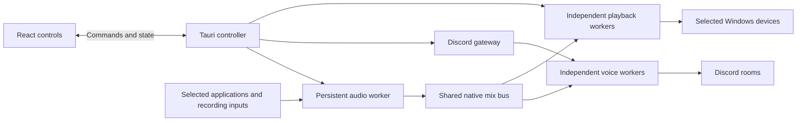

# Architecture

Echocord is a native audio application with a Tauri/React control surface. Windows audio capture, mixing, output, credentials, and recovery belong to Rust. Frontend IPC carries commands, state, and bounded scalar telemetry; it never carries PCM sample buffers.

## Ownership and lifetimes

- One persistent audio worker owns up to eight capture sources and the shared 48 kHz stereo mix. Adding a source starts capture independently of output connections.
- One credential-bearing Discord gateway manages bot identity and per-server voice negotiation. Independently disposable voice workers send the common mix to selected rooms using voice-session credentials.
- Each Windows playback output has its own disposable native worker and reader. A slow or failed output must not stall the producer or its peers.
- The parent/controller manages intent, handles, generations, reservations, persistence, and shutdown. The frontend remains an observer/control surface.

Four destinations may be configured in total, including at most three playback devices. The bot can occupy only one room per server, so configured or retiring Discord outputs reserve their server. Broadening this identity/lifecycle model requires an explicit design review.

## Capture and mixing

Application capture selects an exact process identity and its process tree. A restarted process requires selection again; executable-name matching, PID reuse, default microphones and broad desktop fallback are not acceptable substitutes. Recording endpoints are selected explicitly and support 44.1/48/96 kHz mono/stereo PCM. Nominal format conversion bypasses filtering at 48 kHz; other supported rates use a preallocated sinc converter. This conversion remains enabled independently of clock correction. Native discontinuities and capture lifetime generations fence retained conversion history and queued samples.

Recording negotiation prefers 48 kHz, then 44.1 kHz, then 96 kHz, with mono/stereo only. Conversion stages 128 native frames at a time, sanitizes non-finite samples before filtering and preserves sample alignment across callback boundaries. The pinned CPAL correction treats Windows packets marked silent as correctly represented silence without reading their payload, and preserves uncertain capture timestamps as unavailable for clock estimation. Playback uses Windows conversion through CPAL for the endpoint's nominal format. See [dependency patch scope](../patches/README.md).

Source gain and mix-only mute are independent. Source meters observe post-gain audio before source mute, so muted activity remains visible; original application playback is unaffected by the mix-only mute. Source mute keeps capture and clock correction warm. Destination gain/mute applies to each reader independently. There is no implicit monitor, routing matrix, recording-file feature or loudness normalization.

### Clock correction and peak limiting

Sync correction defaults on at capture-to-mix and mix-to-physical-playback crossings. Each crossing owns a bounded asynchronous sinc resampler. A timestamp-based rate estimator observes each whole native packet/callback once, using cumulative frame positions; a slow queue-depth controller corrects residual error. The resampler keeps a continuous phase while changing its ratio. Discord's paced software reader shares the mix clock and has no extra correction stage. Turning correction off preserves nominal recording conversion and the legacy bounded buffering path.

Processing must never treat synthetic starvation silence as captured input. Exact reads preserve valid frame counts, exposure times and continuity generations; a completion-time fence rejects audio that became stale during a read or processing step. Retained filter history is part of the age bound. Stop/start and source replacement invalidate that source's lifetime, while destination mute invalidates only that destination's queued/history data. Parent-observed epochs survive coalesced control messages, including rapid changes back to the original value.

Limit loud peaks defaults off. When enabled, one stereo-linked processor acts on the common source sum before the final sample clamp, adding exactly 176 frames of delay at 48 kHz. The original unlimited sum still drives overload indication. The limiter uses a shared gain for both channels, a bounded interpolated peak detector and fixed lookahead; it is not normalization or a reconstructed/codec true-peak guarantee. Interpolated peaks can trigger reduction even when native samples remain below the overload threshold, so loud material may become quieter without an overload warning. Toggling inserts or discards the fixed delay and can briefly interrupt sound. Ordinary source edits pass through its fixed delay without resetting peers. Whole-engine discontinuity/stale recovery and limiter mode changes clear retained history before new bus output. Destination controls remain downstream.

The mixer reuses source-owned meter storage between 100 ms publications; its steady 5 ms processing loop allocates no telemetry collections. Application loopback requests Windows' listening-quality conversion. Shared bus timing uses the cross-process performance counter, and continuity fences discard queued audio from before a producer suspension. Each output attaches at the current write position, without replaying historical audio.

## State, cancellation and recovery

Commands target stable source/destination IDs. Session and worker generations fence stale events and telemetry. Discord handshake ordering, late/canceled joins, membership reconciliation and cleanup ambiguity require explicit handling; local worker exit alone is not proof that the bot left remotely. An unresolved reservation remains visible until cleanup is confirmed.

Ordinary source/output failures are contained. A gateway reset stops its Discord cohort while capture and local playback remain independent. Disconnect/Quit cancels retry intent. Recovery never silently changes the selected source, device, server, or room.

Queued room changes belong to their gateway generation and are discarded after its failure. Voice reconnect or unexpected track termination can request a replacement worker for the same current room intent, at most twice per minute. The gateway rechecks current membership, session and mute state before releasing credentials, even when their token is unchanged. Replacement waits for confirmed old-worker exit; an unconfirmed exit never authorizes a second writer. Transient credential-read failures have a fixed 30-second retry budget. Permission failures take effect immediately, with subsequent permission requests spaced by five seconds. Leaving during gateway recovery retains its original 12-second deadline so a resumed gateway can confirm departure.

A capture open/cleanup deadline remains a whole-audio-worker failure boundary: native destructors cannot be safely abandoned. The parent retains process ownership and reports the failure; output readers produce paced silence after the producer becomes stale. Replacing that policy requires confirmed old-owner exit, generation fencing and fresh-audio recovery tests.

## Persistence and credentials

Preferences store explicit identities, gain/mute and ordinary settings under a versioned schema. Restore setup reopens recording inputs; applications wait for Capture against their exact saved identity. Every output restores idle. Unknown future preference versions are preserved rather than overwritten.

The loader checks the version envelope before schema deserialization, applies ordered migrations, validates the final bounded state and normalizes runtime fields. Loading does not write files. Additive settings have defaults; semantic schema changes require a new migration and historical-fixture coverage. Live mutation succeeds independently of saving: a failed write publishes `preferencesWarning`, while `RetryPreferences` saves the current setup without replaying a control action. Only successful persistence clears that warning.

The current settings schema is version 5, with explicit transitions from versions 0–4. Version 5 persists independent clock-correction and limiter choices, defaulting to on/off respectively; the version boundary prevents older releases silently dropping those choices on save. Final route/identity/gain validation follows migration. Future versions, malformed version declarations and oversized existing files are preserved; serialized output is also checked against the file budget before replacing the previous valid file. Atomic writes retain the last valid setup on failure.

One dedicated writer handles disk operations outside the control actor. It holds one active revision and one coalesced pending preferences payload. Changes debounce for 150 ms, with a 500 ms maximum scheduling wait; Retry and Quit flush promptly. `preferencesSaving` describes pending/in-flight work. An older revision's success cannot clear a warning for a newer unsaved setup. Shutdown waits for the latest flush and writer exit within the shell's existing shutdown policy; a failed flush is reported as a failure. These scheduling bounds do not promise a disk-completion deadline.

The bot token is encrypted with Windows current-user DPAPI. It stays backend-owned and is omitted from snapshots and diagnostics. Token validation or saving never joins voice. The UI token field is ephemeral; replacement is restricted while relevant Discord lifetimes remain active.

Source colours are presentation metadata: new sources reuse unused coloured slots; saved neutral/out-of-range slots can recover available colours on load, after valid assignments are reserved. Visible list ordinals are separate from source colours and native IDs.

## UI and telemetry

`ui/src/nativeAdapter.ts` is the production control adapter; fixtures are for tests/preview only. Generated TypeScript types come from the Rust control model. Control snapshots and high-frequency scalar telemetry have separate paths so meters do not rerender the whole control tree.

Meters and histories use bounded observed samples and suspend visual work while hidden. Source/device changes or destination-session changes reset only the relevant history. Local meter/buffer/drop observations are not listener receipt; gateway RTT is not voice latency. Unknown permissions, participant counts or transport facts must not be invented.

Telemetry carries worker-origin monotonic observation times and the controller's envelope time. Repeated control publications cannot renew an old measurement. Source phases remain revision-fenced, while telemetry from an older fader revision can be accepted only for an exact current source identity. Output origins come from actual native callback/PCM handoff observations. Gateway time marks the worker reading the library's latest RTT, not a new heartbeat acknowledgement. The UI expires audio after one second and gateway observations after 2.5 seconds, preserves gaps in measured histories, and derives bounded recent output drop/gap counters separately from session totals.

Timing observations identify a processing lifetime with an exact string epoch. State and audio facts have separate observation origins. Applied ppm describes the completed adjustment, positive when input is consumed faster; it is not a measurement of device clock error. Actual and target queue depth use the same post-consumption boundary in 48 kHz frames. These are local buffered frames, not physical or listener latency. Intentional control changes start new baselines instead of appearing as recovery incidents. Disabled correction is an explicit Off state; absent stages and unmeasured values remain distinct. Limiter telemetry reports maximum applied reduction in the publication window, or null when bypassed/unacknowledged.

[DESIGN.md](../DESIGN.md) specifies the compact desktop presentation. [TESTING.md](TESTING.md) distinguishes portable logic, browser behavior, Windows runtime and physical/listener acceptance.
