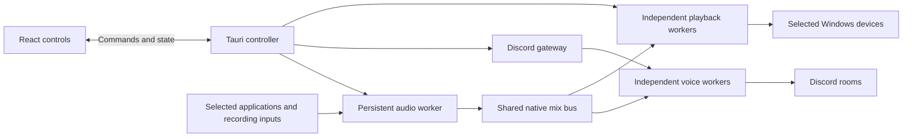

# Architecture

Echocord is a native audio application with a Tauri/React control surface. Windows audio capture, mixing, output, credentials, and recovery belong to Rust. Frontend IPC carries commands, state, and bounded scalar telemetry; it never carries PCM sample buffers.

## Ownership and lifetimes

- One persistent audio worker owns up to eight capture sources and the shared 48 kHz stereo mix. Adding a source starts capture independently of output connections.
- One credential-bearing Discord gateway manages bot identity and per-server voice negotiation. Independently disposable voice workers send the common mix to selected rooms using voice-session credentials.
- Each Windows playback output has its own disposable native worker and reader. A slow or failed output must not stall the producer or its peers.
- The parent/controller manages intent, handles, generations, reservations, persistence, and shutdown. The frontend remains an observer/control surface.

Four destinations may be configured in total, including at most three playback devices. The bot can occupy only one room per server, so configured or retiring Discord outputs reserve their server. Broadening this identity/lifecycle model requires an explicit design review.

## Capture and mixing

Application capture selects an exact process identity and its process tree. A restarted process requires selection again; executable-name matching, PID reuse, default microphones and broad desktop fallback are not acceptable substitutes. Recording endpoints are selected explicitly and currently require 48 kHz mono/stereo support.

Source gain and mix-only mute are independent. Source meters observe post-gain audio before source mute, so muted activity remains visible; original application playback is unaffected by the mix-only mute. Sources sum into a bounded native mix with clipping/overload indication. Destination gain/mute applies to each reader independently. There is no implicit monitor, routing matrix, recording-file feature, or normalization/DSP chain.

## State, cancellation and recovery

Commands target stable source/destination IDs. Session and worker generations fence stale events and telemetry. Discord handshake ordering, late/canceled joins, membership reconciliation and cleanup ambiguity require explicit handling; local worker exit alone is not proof that the bot left remotely. An unresolved reservation remains visible until cleanup is confirmed.

Ordinary source/output failures are contained. A gateway reset stops its Discord cohort while capture and local playback remain independent. Disconnect/Quit cancels retry intent. Recovery never silently changes the selected source, device, server, or room.

## Persistence and credentials

Preferences store explicit identities, gain/mute and ordinary settings under a versioned schema. Restore setup reopens recording inputs; applications wait for Capture against their exact saved identity. Every output restores idle. Unknown future preference versions are preserved rather than overwritten.

The bot token is encrypted with Windows current-user DPAPI. It stays backend-owned and is omitted from snapshots and diagnostics. Token validation or saving never joins voice. The UI token field is ephemeral; replacement is restricted while relevant Discord lifetimes remain active.

Source colours are presentation metadata: new sources reuse unused coloured slots; saved neutral/out-of-range slots can recover available colours on load, after valid assignments are reserved. Visible list ordinals are separate from source colours and native IDs.

## UI and telemetry

`ui/src/nativeAdapter.ts` is the production control adapter; fixtures are for tests/preview only. Generated TypeScript types come from the Rust control model. Control snapshots and high-frequency scalar telemetry have separate paths so meters do not rerender the whole control tree.

Meters and histories use bounded observed samples and suspend visual work while hidden. Source/device changes or destination-session changes reset only the relevant history. Local meter/buffer/drop observations are not listener receipt; gateway RTT is not voice latency. Unknown permissions, participant counts or transport facts must not be invented.

[DESIGN.md](../DESIGN.md) specifies the compact desktop presentation. [TESTING.md](TESTING.md) distinguishes portable logic, browser behavior, Windows runtime and physical/listener acceptance.
